# ZPassword

A password vault for Windows and Linux that never goes online. Everything you
store lives in one encrypted file on your computer. There is no account, no
sync, no telemetry and no updater.

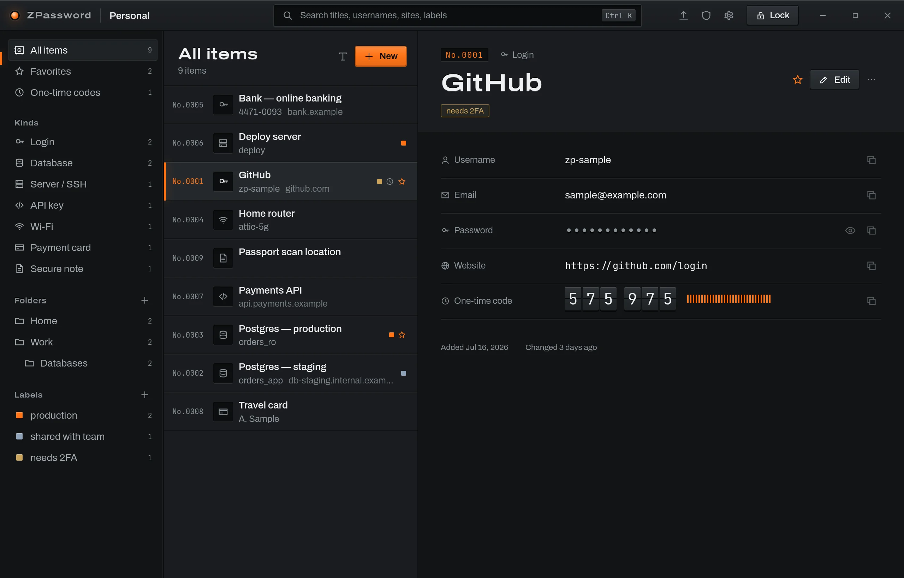


## Screenshots

| | |
|---|---|
| 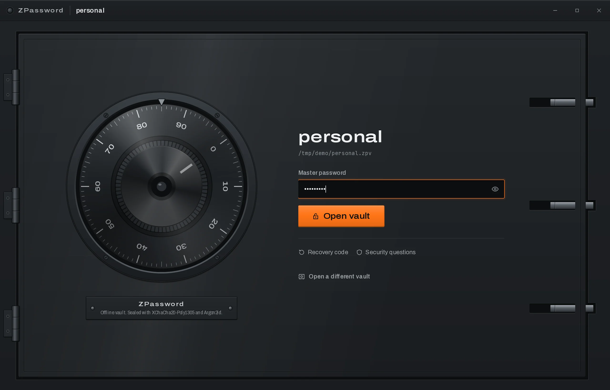 Unlocking: the dial turns as you type | 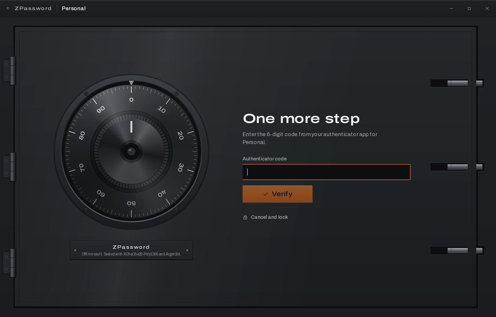 Optional authenticator-app step |
| 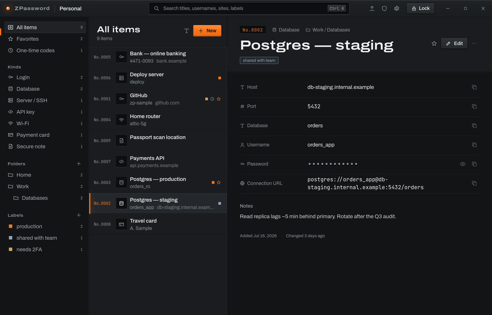 A database credential with custom fields | 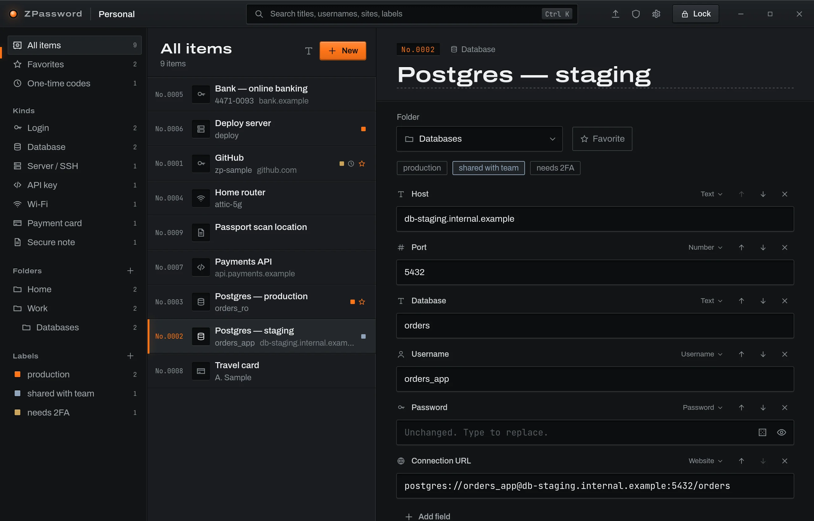 Editing fields, folders and labels |
| 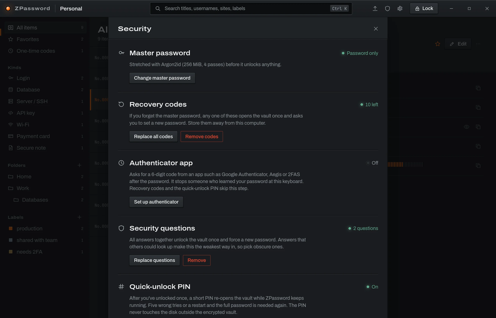 Every way in, in one place | 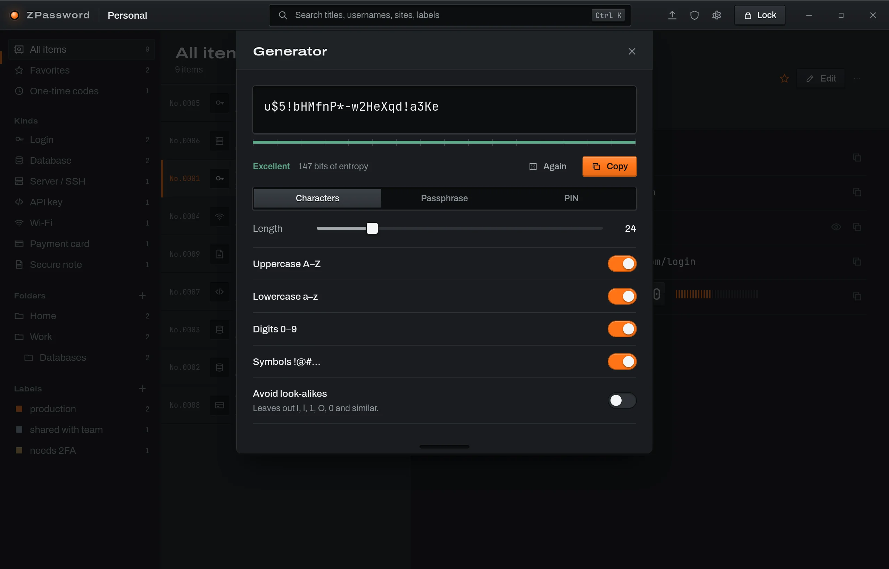 Password and passphrase generator |
| 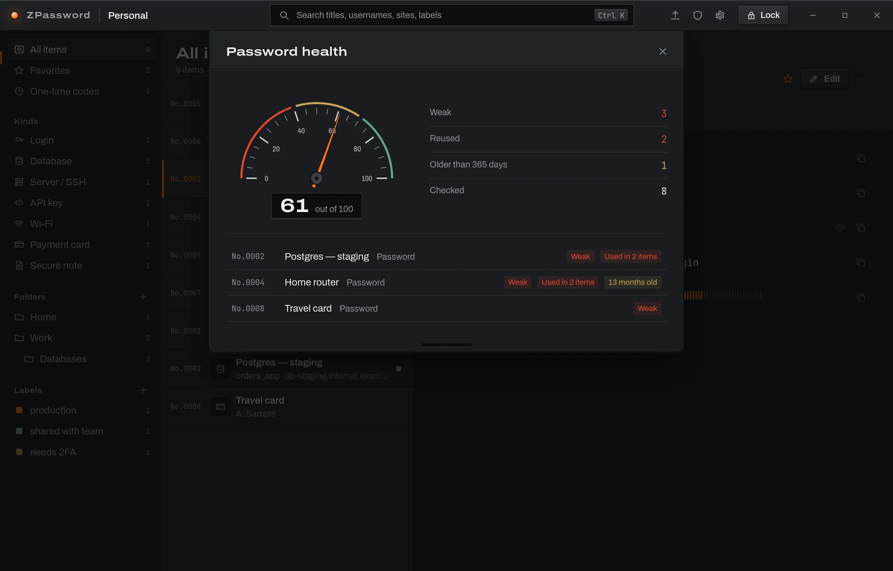 Weak, reused and old passwords | 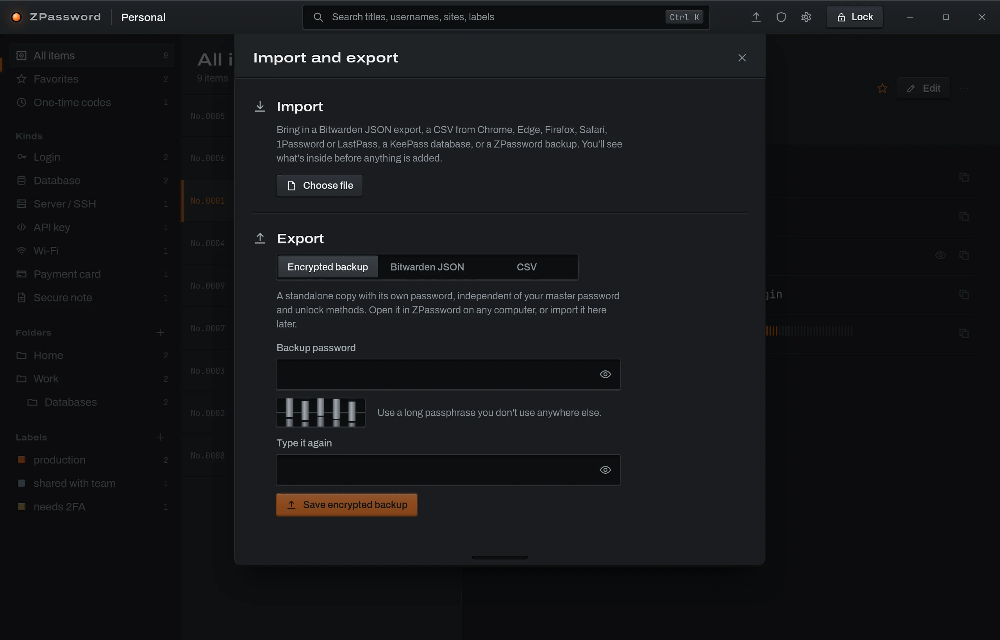 Import from other managers |
| 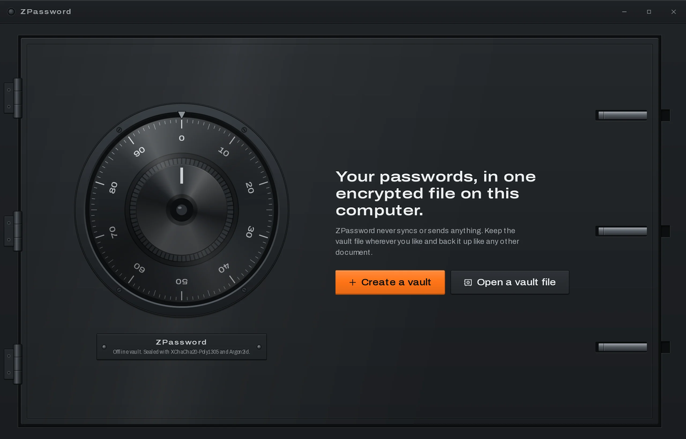 First start | 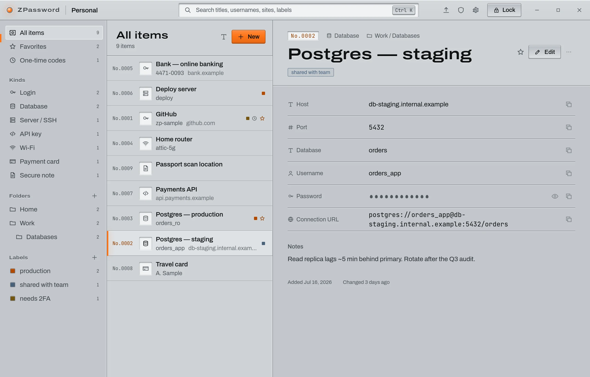 The light "aluminium" finish |
| 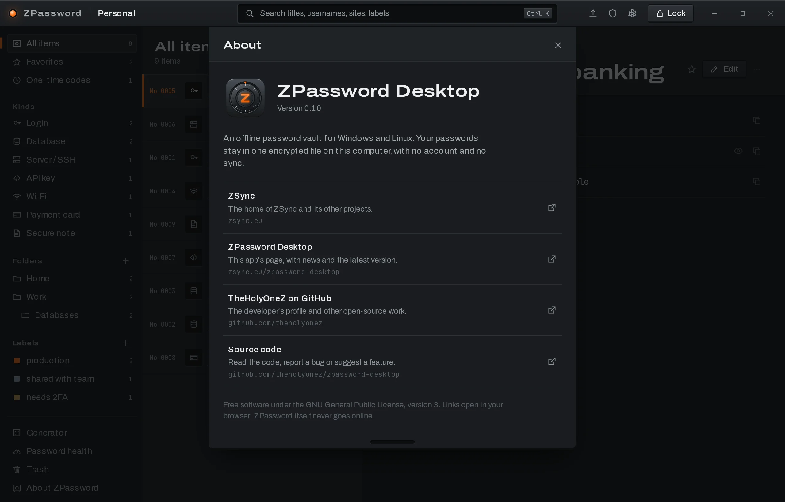 About, with links to the project | |

## What it does

**Store anything with a password in it.** Logins come first (username, email,
password, website, one-time code), with templates for databases, servers/SSH,
API keys, Wi-Fi, payment cards, identities and secure notes. Any item can have
extra fields of any type: text, password, hidden text, URL, number, date,
phone, long text or one-time code.

**Keep it organised.** Nested folders, coloured labels, favorites, notes,
search across titles, usernames, sites and labels (`Ctrl K`), and a trash you
can restore from. Every changed password is kept in the item's history.

**Open it your way.**

- Master password, optionally combined with a **keyfile** and/or a **YubiKey**
  (HMAC-SHA1 challenge-response). With either, someone who steals the file and
  knows the password still can't open it.
- **Quick-unlock PIN** while ZPassword keeps running.
- **Windows Hello** on Windows, or the **desktop keyring** on Linux.
- **Authenticator app** (Google Authenticator, Aegis, 2FAS…) as a second step
  after unlocking.

**Get back in if you forget.** Ten single-use recovery codes, and optional
security questions. Both make you set a new master password right away.

**Everyday tools.** Password and passphrase generator, live one-time codes for
your accounts, an offline password-health report, clipboard that clears itself
after 30 seconds, auto-lock when idle, when the screen locks or when the
computer sleeps, and rolling encrypted backups next to the vault file.

**Move in and out.** Import from Bitwarden (JSON or CSV), Chrome, Edge, Brave,
Firefox, Safari, 1Password, LastPass (CSV) and KeePass (`.kdbx`). Export as an
encrypted ZPassword backup, Bitwarden JSON or CSV.

## Getting started

1. **Install.** Build it yourself (see [Build it yourself](#build-it-yourself)).
   You get a `.deb`, `.rpm` and AppImage on Linux and an `.msi`/`.exe`
   installer on Windows.
2. **Create a vault.** Pick where the file goes (the default is fine) and choose
   a master password. ZPassword measures its strength and won't accept a weak
   one. Nobody can reset this password for you.
3. **Save your recovery codes.** Right after creating the vault you get ten
   codes. Save them to a file or print them and keep them away from the
   computer. Each one opens the vault once.
4. **Add more ways in (optional).** Under **Security** (shield icon, top right)
   you can add an authenticator app, a PIN, Windows Hello or the keyring,
   security questions, a keyfile or a YubiKey.
5. **Add items or import.** Press **New** (or `Ctrl N`) for a login, or pick
   another kind from the menu. To bring passwords over from another manager,
   use **Import and export** (arrow icon, top right). You see what's in the
   file before anything is added, and duplicates are skipped.
6. **Use it.** Copy a username, password or one-time code with the copy button
   next to it. Secrets stay hidden until you press the eye. `Ctrl L` locks the
   vault.

Back up the vault file like any other document. It is useless without your
master password and any keyfile or YubiKey you added. Older versions are
kept in a `<vault>.backups` folder next to it, and **Settings** lets you
restore one.

| Shortcut | Action |
|---|---|
| `Ctrl K` / `Ctrl F` | Search |
| `Ctrl N` | New login |
| `Ctrl S` | Save while editing |
| `Ctrl G` | Generator |
| `Ctrl L` | Lock |
| `↑` `↓` | Move through the list |

## Security

**How the file is protected.** A random 256-bit vault key encrypts the
contents with XChaCha20-Poly1305. Every way of unlocking (password, recovery
code, security questions, device) wraps that same key with its own
key-encryption key, like LUKS key slots. The master password is stretched with
Argon2id (at least 256 MiB of memory, tuned to about a second on your
machine). A keyfile and a YubiKey response are mixed into the same derivation.
The whole file header is authenticated, so changing any byte of the file makes
it undecryptable.

**What crosses into the interface.** Decryption happens in Rust. The window only
receives what it shows; a hidden value is sent only when you press the eye,
and copying goes straight from Rust to the clipboard. Copied secrets are
excluded from clipboard history (Windows) and cleared after a timeout, but only
if the clipboard still holds what ZPassword put there.

**On disk.** Saves are atomic (write, sync, rename), and each new file is
decrypted once in memory before it replaces the old one. An OS file lock stops
two copies of ZPassword writing the same vault. On Linux, core dumps are
disabled for the process.

**Be aware of what each method does and doesn't do:**

- The **authenticator app** step is a gate, not encryption. It stops someone at
  your keyboard who learned your password. It does not protect a stolen vault
  file; a keyfile or YubiKey does that.
- **Security questions** are only as strong as your answers. Anything that can be
  looked up online can be guessed.
- The **PIN** only exists in memory while the app runs. Five wrong tries or a
  restart and the master password is needed again.
- The **Linux keyring** option means anyone logged in as you can open the vault
  without the password.
- **Backups keep the unlock methods that were valid when they were taken**,
  including used recovery codes and old passwords. Delete old backups if that
  matters to you.
- No password manager can protect you from malware already running as your
  user while the vault is open.

## Build it yourself

You need **Rust 1.89+** (via [rustup](https://rustup.rs)), **Node.js 22+** and
**pnpm** (`npm install -g pnpm`).

### Linux system packages

Arch / CachyOS / Manjaro:

```bash
sudo pacman -S --needed base-devel webkit2gtk-4.1 libsoup3 librsvg libappindicator-gtk3 openssl libusb systemd-libs
```

Debian / Ubuntu (22.04+):

```bash
sudo apt install build-essential curl file libwebkit2gtk-4.1-dev libssl-dev \
  libayatana-appindicator3-dev librsvg2-dev libudev-dev libusb-1.0-0-dev libdbus-1-dev
```

Fedora:

```bash
sudo dnf install @c-development webkit2gtk4.1-devel openssl-devel \
  libappindicator-gtk3-devel librsvg2-devel systemd-devel libusb1-devel
```

### Windows

Install the **Visual Studio Build Tools** with the "Desktop development with
C++" workload. WebView2 ships with Windows 10 (recent updates) and 11.

### Build and run

```bash
git clone <this repository> ZPassword-Desktop
cd ZPassword-Desktop
pnpm install

pnpm tauri dev      # run it in development mode
pnpm tauri build    # build installers
```

Installers land in `target/release/bundle/`:

| Platform | Files |
|---|---|
| Linux | `deb/*.deb`, `rpm/*.rpm`, `appimage/*.AppImage` |
| Windows | `msi/*.msi`, `nsis/*-setup.exe` |

To build only some Linux formats: `pnpm tauri build --bundles deb,rpm`.

### YubiKey setup

Configure slot 2 of your key for HMAC-SHA1 challenge-response once, for
example with `ykman otp chalresp --generate 2`. On Linux your user needs access
to the USB device; most distributions handle this through `libu2f-udev` or
`yubikey-personalization`. If not, add `/etc/udev/rules.d/70-yubikey.rules`:

```
SUBSYSTEM=="usb", ATTRS{idVendor}=="1050", MODE="0660", TAG+="uaccess"
```

## Tech stack

| Part | Built with |
|---|---|
| App shell | [Tauri 2](https://tauri.app) (WebKitGTK on Linux, WebView2 on Windows) |
| Core | Rust 2024: `argon2`, `chacha20poly1305`, `hkdf`/`sha2`, `zeroize`, `zxcvbn` |
| Import | `csv`, `keepass` |
| Platform | `arboard` (clipboard), `challenge_response` (YubiKey), `windows` (Hello), `keyring` + `zbus` (Linux) |
| Interface | React 19, TypeScript, Vite, TanStack Query, Zustand |
| Motion | GSAP |
| Type | Archivo and JetBrains Mono, bundled locally |

## Development

```
crates/zpass-core     encryption, file format, key slots, data model, TOTP, generator, health
crates/zpass-import   Bitwarden / CSV / KeePass / ZPassword import, JSON and CSV export
src-tauri             Tauri app: session state, IPC commands, clipboard, OS integration
src                   React interface (design tokens in src/styles/tokens.css)
scripts               strip-comments.mjs
assets/screenshots    images used here
```

```bash
cargo test --workspace         # crypto, key slots, file tampering, import/export, full IPC flow
pnpm typecheck && pnpm test    # interface
cargo clippy --workspace --all-targets -- -D warnings
cargo deny check advisories licenses
node scripts/strip-comments.mjs --dry-run   # list comments that would be removed
```

`scripts/strip-comments.mjs` removes comments from all Rust, TypeScript, CSS,
TOML, YAML and HTML files. It keeps tool directives (`eslint-disable`,
`@ts-…`) and license headers. TypeScript is parsed with `@babel/parser`, so
strings, URLs and JSX text are never touched. Run it without `--dry-run` to
apply.

### Vault file format

`ZPASSVLT` magic, a format version, a JSON header listing the key slots (each
with its own salt, Argon2id parameters and wrapped vault key), then the
XChaCha20-Poly1305 encrypted contents, authenticated against the header. The
contents are JSON, so newer versions can add fields without breaking older
files.

## Links

| | |
|---|---|
| [zsync.eu](https://zsync.eu) | ZSync, the home of this and other projects |
| [zsync.eu/zpassword-desktop](https://zsync.eu/zpassword-desktop) | ZPassword Desktop's project page |
| [github.com/theholyonez](https://github.com/theholyonez) | The developer, TheHolyOneZ, on GitHub |
| [github.com/theholyonez/zpassword-desktop](https://github.com/theholyonez/zpassword-desktop) | Source code, bug reports and feature requests |

The same links are in the app under **About ZPassword** at the bottom of the
sidebar. They open in your browser, and only these four addresses can be opened.

## License

ZPassword Desktop is free software, released under the
[GNU General Public License v3.0](LICENSE). You may use, study, share and change
it; if you distribute a modified version, it must be under the same license
with its source code available.
